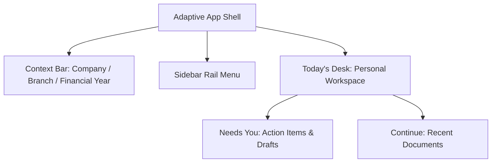
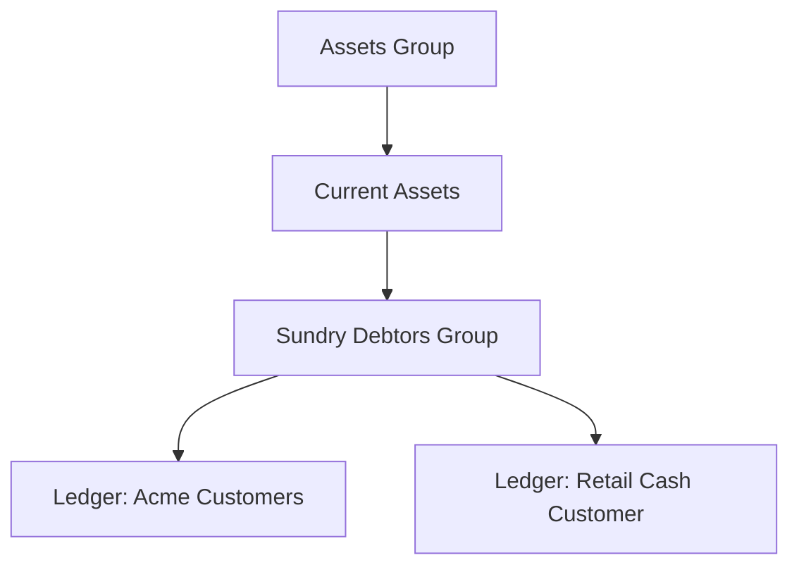

# algoERP — End-User Help Manual & Guide

Welcome to the **algoERP** Help Center. This guide is designed to help daily operators (accountants, sales clerks, warehouse managers, and administrators) navigate and master the system. 

algoERP is built with a unique design philosophy codenamed **Ledger & Linen**. Rather than a cold, generic SaaS console, the workspace behaves like a calm, focused physical desk—designed to make dense transactional work feel clean, personal, and highly efficient.

---

## Table of Contents
1. [Navigating Your Desk (Workspace & Navigation)](#1-navigating-your-desk-workspace--navigation)
2. [Setting Up the System (Organization & Core Data)](#2-setting-up-the-system-organization--core-data)
3. [Managing Financial Accounts (Chart of Accounts & Ledgers)](#3-managing-financial-accounts-chart-of-accounts--ledgers)
4. [Managing Inventory & Warehousing (Items, Batches & SKUs)](#4-managing-inventory--warehousing-items-batches--skus)
5. [Transactional Workflows (Documents & Vouchers)](#5-transactional-workflows-documents--vouchers)
6. [Understanding the Document Lifecycle](#6-understanding-the-document-lifecycle)
7. [End-User FAQ & Troubleshooting](#7-end-user-faq--troubleshooting)

---

## 1. Navigating Your Desk (Workspace & Navigation)

The interface is optimized for daily users who spend 6–10 hours in the system. 



### The Today's Desk (Dashboard)
When you log in, you are greeted by **Today's Desk**—a clean surface displaying your relevant next tasks rather than confusing, cluttered charts.
* **Warm Greetings:** A personalized greeting showing who you are logged in as, your active company, branch, and financial year.
* **"Needs You" Section:** Actionable sticky-note style alerts, such as draft vouchers awaiting completion, credit limit warnings, or approvals requiring your attention.
* **"Continue" Section:** Quick links to the last 3–5 items or documents you worked on so you can resume immediately.

### The Session Context Bar
At the top of your screen is the **Context Bar**. It shows:
1. **Active Company:** The company file currently loaded.
2. **Active Branch:** The location you are currently posting transactions under.
3. **Financial Year (FY):** The accounting year (e.g., `FY-2026`) for transactions.

> [!IMPORTANT]  
> Always double-check your Context Bar settings before posting vouchers. Transactions will be posted under the selected Branch and Financial Year.

### Navigation Sidebar
* **Desktop & Tablet:** An adaptive navigation rail with titles grouping related modules together. 
* **Mobile:** A slide-out drawer optimized for hand-held viewports.
* **Active State Highlight:** The screen you are currently on is highlighted in a soft **Lagoon** pill.

---

## 2. Setting Up the System (Organization & Core Data)

Before entering sales or purchase transactions, the core settings must be configured. These reside under the **Organization** section of the navigation menu.

### Financial Years
Manage the periods of time under which your accounting is grouped.
* **Creating a Year:** Go to **Financial Years** and click **+ New Financial Year**. Define the `Start Date` and `End Date` (e.g., Jan 1 to Dec 31).
* **Setting Default:** Mark a specific year as default so it auto-loads for users.
* **Locking Years:** Once audits are completed, you can change the status from **Open** to **Closed** or **Locked**.
  > [!WARNING]  
  > Once a financial year is **Locked**, no users (including admins) can create, edit, or cancel vouchers within that date range.

### Branches & Currencies
* **Branches:** Manage multiple physical offices or retail outlets. Each transaction tracks the branch it originated from to allow multi-location reporting.
* **Currencies:** Set up your base currency (e.g., **AED** for UAE) and foreign trading currencies (e.g., **USD**, **EUR**). Daily exchange rates can be updated under **Currency Rates** to automate foreign transactions.

### Address Book (Contacts)
A unified contact directory for all entities interacting with your business.
* **Types of Contacts:**
  * `COMPANY` (Corporate customers or suppliers)
  * `INDIVIDUAL` (Retail customers)
  * `VENDOR` (Supplier companies/individuals)
  * `EMPLOYEE` (Staff members)
* **Fields:** Standardize phone, email, full address details (Building, Street, PO Box, Emirates/City, Country), and the tax **TRN (Tax Registration Number)**.

> [!NOTE]  
> New contacts default to **Inactive** (unchecked). Ensure you check **Is Active** to make the contact visible when mapping ledger accounts or picking customers in invoices.

---

## 3. Managing Financial Accounts (Chart of Accounts & Ledgers)

All monetary actions flow through the General Ledger. The system operates on a tree structure of **Account Groups** containing individual **Ledgers**.



### Account Groups
Create folders to group your ledgers (e.g., *Fixed Assets*, *Sundry Debtors*, *Direct Expenses*).
* **Sub-groups (Self-FK):** You can set an Account Group as a child of another group to create infinite levels of hierarchy.
* **System Defined:** System-locked groups cannot be renamed or deleted as they map directly to automated tax and valuation engines.

### Ledger Master
The individual accounts where values are posted.
1. **Details Tab:** Set the account name, code, parent Account Group, currency, and opening balance (Decimal).
2. **Bank Details Tab:** (For Bank ledgers) Store the Account Number, IBAN, Swift Code, and Bank Branch.
3. **Credit Settings Tab:** (For Customers/Suppliers) Set the `Credit Limit` (maximum outstanding allowed) and `Credit Period` (due days).
4. **Tax Settings Tab:** Assign the default Tax Category, TRN number, and specify the type of supply.

---

## 4. Managing Inventory & Warehousing (Items, Batches & SKUs)

Ensure your stock catalogs are correctly entered for accurate inventory valuations and warehouse tracking.

### Categorizing Items
* **Brands & Categories:** Flat attributes to classify products (e.g., Brand: *Acme*, Category: *Hardware*).
* **Inventory Groups:** Hierarchical folders (e.g., *Electronics* -> *Smartphones*). Items inherit tax rules and GL ledger mappings from their group when specified.
* **Units of Measure (UOM):** Standard items (e.g., `PCS`, `KG`, `BOX`). You can configure **UOM Conversions** to establish ratios (e.g., `1 BOX = 12 PCS`) for automatic conversions during purchases and sales.

### The Inventory Item
When creating a physical product or service, you can toggle several flags:

| Flag | Meaning when checked |
|---|---|
| **Is Sales Item** | Visible in Sales Invoices and Quotations. |
| **Is Purchase Item** | Visible in Purchase Orders and Bills. |
| **Is Stock Item** | Tracks inventory quantity and generates stock ledger entries. |
| **Is Batch Tracked** | Requires selecting or creating a batch with manufacturing/expiry dates. |
| **Is Serialized** | Requires tracking unique serial numbers. |
| **Is Service** | Does not affect stock quantities (e.g., installation labor). |

* **GL Mappings:** Link the item to specific ledger accounts (e.g., Sales Account, Purchase Account, Stock Adjustment Account) to automate bookkeeping behind the scenes.

### Batches, SKUs, and Godowns
* **Batches:** Essential for food, pharmaceuticals, or items with warranties. Tracks manufacturing date, expiry date, purchase cost, and default selling price.
* **SKUs (Stock Keeping Units):** Allows defining multiple barcode and packaging variations for a single inventory item (e.g., pack of 1, bundle of 5).
* **Godowns:** Virtual or physical warehouses. You can assign items to specific godowns and perform stock transfers between them.

---

## 5. Transactional Workflows (Documents & Vouchers)

Vouchers are the active documents that record business operations. The central document engine supports a structured header, line details, automatic tax calculations, and a standardized status lifecycle.

### Example: Posting a Sales Invoice
The Sales Invoice screen simulates a physical document folder. Follow these steps to post a sale:

1. **Header Details:**
   * Select the **Party** (Customer Ledger). This will automatically fetch their TRN, Address, and default credit settings.
   * Verify the **Date** and select the **Voucher Series** (which determines the invoice number sequence).
2. **Item Lines:**
   * Add a line and search for the **Inventory Item**.
   * If the item is batch-tracked, pick the appropriate **Batch Number**.
   * Enter the **Quantity** and **Rate**. 
   * Apply any **Discount %** (subject to maximum discount caps configured by administrators).
   * The **Tax Category** and VAT amount are auto-resolved based on the customer and item settings.
3. **Calculations:**
   * The **Line Engine** runs in real-time. As you type, it recalculates sub-totals, discounts, VAT, and the final grand total.
4. **Finalizing:**
   * **Save Draft:** Saves your work. It is editable and does *not* post values to the ledger or adjust inventory.
   * **Post Invoice:** Finalizes the document. This commits the values immediately.

> [!TIP]  
> If you make a mistake, you cannot edit or delete a **Posted** invoice. You must use the **Cancel/Void** function, which automatically reverses the stock and financial ledger entries.

---

## 6. Understanding the Document Lifecycle

Vouchers in algoERP progress through a strict state machine to maintain audit integrity:

```
[Draft] ────► [Approved]* ────► [Posted] ────► [Cancelled]
   │              │
   └──────────────┴───────────► [Rejected]
```
*\*Note: The Approved state is only active if the selected Voucher Series has "Require Approval" enabled.*

### State Descriptions

1. **Draft:** 
   * **Behavior:** The document is in progress. 
   * **Ledger Impact:** **No impact** on General Ledger (GL) or Stock levels.
   * **Actions Allowed:** Fully editable. Lines can be modified, deleted, or re-ordered. Can be deleted entirely.

2. **Approved:** 
   * **Behavior:** The supervisor has checked and authorized the draft.
   * **Ledger Impact:** **No impact** on GL or Stock. It is a waiting state.
   * **Actions Allowed:** Locked for editing by standard clerks. Ready to be Posted.

3. **Posted:** 
   * **Behavior:** The document is finalized and legally locked.
   * **Ledger Impact:** **Real-time postings generated.** Debit/Credit ledger rows are written. Stock ledger is updated (quantities deducted/added). Outstanding customer balances are adjusted.
   * **Actions Allowed:** **Not editable.** Cannot be deleted. Can only be **Cancelled** (voided).

4. **Rejected:** 
   * **Behavior:** A supervisor rejected a Draft or Approved voucher. A mandatory rejection reason must be recorded.
   * **Ledger Impact:** **No impact** on GL or Stock.
   * **Actions Allowed:** Can be reverted to Draft, revised, and resubmitted.

5. **Cancelled:** 
   * **Behavior:** The voucher has been voided. 
   * **Ledger Impact:** The system automatically posts **reversing debit/credit and stock rows** (swapping ins/outs) to neutralize the original voucher.
   * **Actions Allowed:** Permanently locked. Cannot be reopened. Reversing linkages are saved for auditors.

---

## 7. End-User FAQ & Troubleshooting

### Q: Why can't I edit a voucher?
* **A:** Check the status chip at the top. If the status is **Posted**, **Cancelled**, or **Rejected**, editing is disabled. If the status is **Draft**, make sure the transaction's date does not fall into a **Locked/Closed** Financial Year.

### Q: What is the difference between soft delete and hard delete?
* **Soft Delete:** Marks records (like Ledgers or Items) as *Inactive* (`is_active = false`). They remain in your archives but will no longer appear in pickers when creating new transactions.
* **Hard Delete:** Permanently removes the record from the database (e.g., Brands, Categories). This is only allowed if the record is *not* used by any active items or vouchers.

### Q: Why is my customer's TRN not printing on the invoice?
* **A:** Go to **Accounts** -> **Ledgers**, edit the Customer Ledger, open the **Tax Settings** tab, and verify that the TRN is correctly entered and the VAT rate is selected.

### Q: Why does the system block me from saving an item without a batch?
* **A:** The item has the **Is Batch Tracked** option turned on in its master card. The system requires batch numbers, manufacturing dates, and expiry dates to track this item. If this was a mistake, deactivate the batch flag on the item card (only possible if no transactions have been posted yet).

### Q: I cancelled a voucher, but the inventory is still incorrect. Why?
* **A:** If you cancelled a voucher that had downstream links (for example, cancelling a Delivery Note that was already converted into a Sales Invoice), you must cancel the Sales Invoice first. Ensure all link chains are cancelled from newest to oldest.

---

*For further assistance, please contact your internal system administrator or log a ticket under the Help & Diagnostics menu.*
